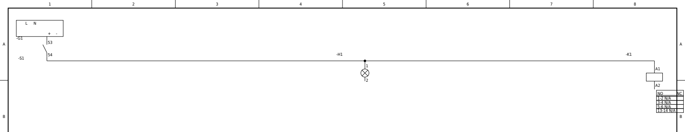
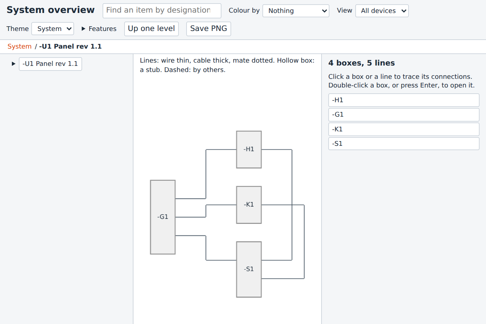

# Demo

**Fransys, for tomorrow's engineers.**

**Vision.** Every electrical system has one open source of truth, from the first idea to the end of its life.

**Mission.** Fransys takes the drawing, copying and checking off electrical engineers, so they can spend their time engineering the system.

## What Fransys is

Fransys is an open-source Python toolkit for electrical systems. Describe your parts, circuits and units once, in code, and Fransys draws the schematics, writes the lists and checks the connections, all from that one source.

## The circuit

These lines describe the circuit. The script around them is what made everything below.

```python
    psu = c.device("G1", "DEMO-PSU-24")
    dc = c.dc_supply("24VDC", psu)
    s1 = c.device("S1", "DEMO-CTR-BLOCK-1NO1NC")
    h1 = c.device("H1", "DEMO-LAMP-24")
    k1 = c.device("K1", "DEMO-CTR-3P-24")
    load = c.parallel(h1.lamp, k1.coil)
    c.series(dc.plus, s1.no, load, dc.minus, wire=(BU, 0.75))
```

[Full script](https://github.com/OleJBondahl/fransys/blob/main/website/demo.py)

## What it makes

The schematic. Tap it for the full PDF.

[](../assets/demo/panel-v1.1.pdf)

The system overview, one HTML file: boxes and wires you can open, search and trace. Tap it to open it.

[](../assets/demo/overview.html)

## Share this page

<p style="text-align:center"></p>
